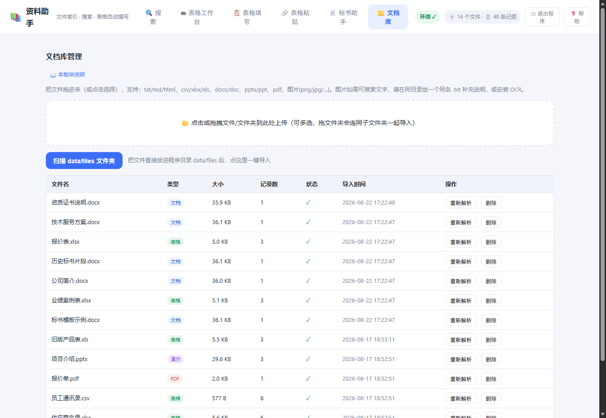
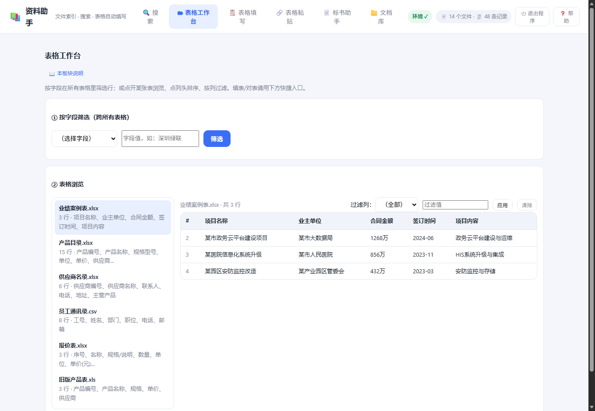
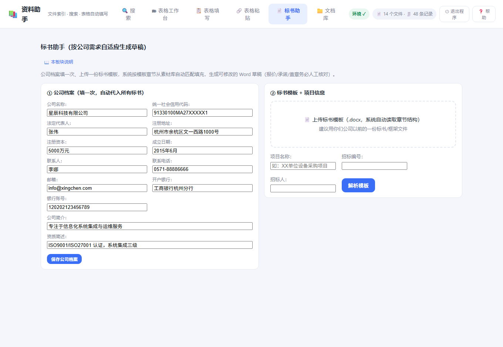

# 资料助手

> **纯本地、免安装、不联网**的「文档 / 表格 / PDF / 图片」检索 + 表格自动填写 + 标书助手。
> 把一堆文件丢进去就能按关键词查资料；给你一张表格，能按“标题列”自动把其它字段填好；还能按公司档案 + 模板生成标书草稿。**数据全部留在你自己电脑上。**

- 🖥 Windows 桌面程序，**双击即用，不需要安装 Python**
- 🔒 **完全离线**：不需要联网、不需要注册，数据不出本机
- 🧩 双版本：Win10/11 标准版 + Win7 兼容版

---

## ✨ 功能

| 功能 | 说明 |
| --- | --- |
| 🔍 **全文搜索** | txt/md/html、csv/xlsx/xls、docx/doc、pptx/ppt、pdf、图片；可按 **表格 / 文档 / PDF / 演示 / 图片** 类型筛选；命中高亮，选中的记录可复制或导出 Excel |
| 📖 **阅读模式** | 搜索结果点「阅读」看全文，关键词定位（上一个/下一个），PDF/PPT 翻页，图片直接预览 |
| 🗂 **表格工作台** | 按字段跨所有表格筛选（如「供应商 = 某公司」）；表格浏览、点列头排序、按列过滤 |
| 📋 **表格填写** | 上传一张模板表，按“标题列”从已导入的资料里自动匹配并填好其它字段 |
| 🔗 **表格粘贴** | 从另一张表里贴一行 / 一列 / 几行几列过来 |
| 📄 **标书助手** | 公司档案填一次 + 上传标书模板，按章节自动匹配素材，生成可修改的 Word 草稿 |
| 📂 **文件夹导入** | 拖整个文件夹进去（递归，保留子目录结构） |
| ♻️ **同名重导** | 内容没变会跳过；内容改过会**自动替换旧版**，不会越堆越多 |

> ⚠️ 标书助手生成的是**草稿**，报价 / 承诺 / 签字盖章请务必人工核对后再使用。

---

## 🖼 截图

| 文档库 | 搜索 |
| --- | --- |
|  |  |

| 表格工作台 | 表格填写 |
| --- | --- |
|  |  |

| 表格粘贴 | 标书助手 |
| --- | --- |
|  |  |

| 帮助中心 |
| --- |
|  |

---

## ⬇️ 下载

- **GitHub Releases**：<https://github.com/mjw0520/ziliao-zhushou/releases>
- **Gitee Releases（国内访问更快）**：<https://gitee.com/majunwei0520/ziliao-zhushou/releases>

| 版本 | 适用系统 | 文件 |
| --- | --- | --- |
| 程序版（推荐，不带任何数据） | Win10 / 11 | `资料助手-程序版.zip` |
| 程序版（推荐，不带任何数据） | Win7 SP1+ | `资料助手-程序版-Win7.zip` |
| 带示例数据版（体验用） | Win10 / 11 | `资料助手-分发包.zip` |
| 带示例数据版（体验用） | Win7 SP1+ | `资料助手-分发包-Win7.zip` |

**用法**：解压 → 双击 `资料助手.exe` → 浏览器自动打开 → 用完点网页右上角「⏻ 退出程序」。
对方电脑**不需要装 Python**，也不需要装任何依赖。

> 如果浏览器没自动打开，手动访问 `http://127.0.0.1:8000`。
> 若杀毒软件误报，选择“允许运行”即可（PyInstaller 打包的绿色软件常见现象）。

---

## 🚀 快速开始

1. **导入文件**：「文档库」页把文件/文件夹拖进虚线框；或直接把文件放进程序目录的 `data/files`，点「扫描 data/files 文件夹」。
2. **查资料**：「搜索」页输入关键词，可按类型筛选；选中的记录可复制或导出 Excel。
3. **填表格**：「表格填写」上传模板表 → 选“匹配列”→ 逐行核对 → 导出。
4. **写标书**：「标书助手」填公司档案 → 上传 .docx 模板 → 核对章节 → 生成草稿。

所有数据都在程序旁边的 `data` 文件夹，删掉即清空。

---

## 💬 反馈

用的时候遇到 bug、有建议、或者想要新功能，欢迎发邮件到：

**📧 majunwei_0520@163.com**

（请尽量附上：系统版本、你做的操作、报错截图。这样我能更快定位。）

---

## 🛠 从源码运行 / 自行打包

需要 **Python 3.9+**（Win7 版用 3.9，标准版可用 3.12）。

```bash
# 运行（源码版）
python app.py            # 浏览器打开 http://127.0.0.1:8000
python app.py --port 9000   # 换端口
```

解析组件（pandas / openpyxl / pdfplumber / python-docx / python-pptx / Pillow / xlrd / olefile）缺失时程序会自动降级，txt/csv 仍可用；也可双击 `install_deps.bat` 一键安装（需联网，一次性）。

打包成 exe：改完源码后双击 `一键打包全部版本.bat`（脚本里的构建环境路径需按你本机情况调整），会生成 Win10/11 与 Win7 两个 exe 及 4 个 zip。

**技术栈**：后端 Python 标准库 `http.server` + `sqlite3`（SQLite **FTS5** 全文检索，中文按 2 字 bigram 切分）；前端原生 HTML/CSS/JS，无任何外部依赖，完全离线可用。

---

## 📄 License

本项目采用 **MIT License** —— 你可以自由使用、修改、分发（含商用），只需保留版权声明。

Copyright (c) 2026 马俊威 · 详见 [LICENSE](LICENSE)
